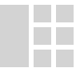

# ExoDeck

<p align="center">
  
</p>

<p align="center">
  <a href="https://github.com/ExoDeck/exodeck/actions/workflows/ci.yml"></a>
  <a href="https://golang.org"></a>
  <a href="LICENSE"></a>
</p>

> **Local-first knowledge management & browser cockpit.**

ExoDeck is a fast, keyboard-driven personal knowledge management (PKM) dashboard and browser start page. It seamlessly brings together bookmark collections, long-form Markdown notes, Excalidraw whiteboards, and BPMN process diagrams into a unified, file-based interface.

Built with a lightweight Go backend and pure vanilla JavaScript/CSS in the frontend, ExoDeck delivers sub-second startup times, full offline support, and zero cloud dependency.

---

## Key Features

- ⚡ **Zero Bloat, Instant Startup**: Pure Go backend serving a vanilla ES2020+ frontend. No heavy frameworks (no React, Angular, or Vue), zero virtual DOM overhead.
- 📁 **100% Local-First & File-Based**: All your data is saved as plain files in local workspace folders:
  - **Grid pages** (`.grid`): Hierarchical dashboards with grouped links and quick notes.
  - **Note pages** (`.md`): Markdown documents with syntax highlighting, auto-sum tables, and media embeds.
  - **Whiteboard pages** (`.excalidraw`): Freeform canvas sketching and visual thinking.
  - **BPMN pages** (`.bpmn`): Structured business process modeling diagrams.
- 🛡️ **Master Password Vault**: KeePass-style master password protection using **Argon2id** key derivation and **AES-256-GCM** encryption. Store passwords, OTP/TOTP secrets, and confidential notes safely without plaintext keys in your configuration.
- ⌨️ **Keyboard-Centric Navigation**: Press `/` to summon the jump search prompt to filter and open pages instantly. Full hotkey coverage for common actions.
- 🔄 **Git-Sync Ready**: Native support for automatic Git commits and sync across workspaces.
- 🌓 **Themes & Typography**: Built-in Dark and Light themes with customizable UI, note, and link font scaling.
- 📦 **Single Self-Contained Binary**: All HTML, CSS, JavaScript, and documentation are embedded directly into the Go executable (`xd` / `xd.exe`).

---

## Quick Start

### 1. Install via Script

#### Linux & macOS

Install or update ExoDeck with a single command:

```bash
curl -fsSL https://raw.githubusercontent.com/ExoDeck/exodeck/main/scripts/install.sh | bash
```

Once installed, simply run `xd` from any terminal.

#### Windows (PowerShell — No Admin Required)

Install or update ExoDeck to your user profile:

```powershell
irm https://raw.githubusercontent.com/ExoDeck/exodeck/main/scripts/install.ps1 | iex
```

The script automatically unblocks `xd.exe` to prevent Windows SmartScreen unrecognized app warnings and adds `xd` to your user `PATH`.

### 2. Pre-built Binaries (Direct Download)

Download the latest release archive for your platform from the [Releases](https://github.com/ExoDeck/exodeck/releases) page:

- **Windows**: `exodeck-v1.0.0-windows-amd64.zip` (or `arm64`)
- **Linux**: `exodeck-v1.0.0-linux-amd64.tar.gz` (or `arm64`)
- **macOS**: `exodeck-v1.0.0-darwin-amd64.tar.gz` (or Apple Silicon `arm64`)

Extract the archive and run the executable:

```bash
./xd
```

Open your browser to [http://localhost:8000](http://localhost:8000).

> [!NOTE]
> **Windows SmartScreen on First Run**:  
> If downloading `xd.exe` directly via a web browser without the installer script, Windows Defender SmartScreen may display an *"Unrecognized app"* warning because the binary is not yet signed with a commercial certificate.
> Click **"More info"** &rarr; **"Run anyway"** (or right-click `xd.exe` &rarr; **Properties** &rarr; check **"Unblock"**).
> Running the PowerShell installer script (`install.ps1`) unblocks the binary automatically. All release binaries are built with open provenance on GitHub Actions.

### 3. Run from Source

**Prerequisites:** Go 1.25+ and Node.js 22+ (only needed if building or linting frontend assets).

```bash
# Clone the repository
git clone https://github.com/ExoDeck/exodeck.git
cd exodeck

# Run directly
go run .

# Or build the standalone binary
go build -o xd .
./xd
```

---

## Configuration (`config.json`)

On first run, ExoDeck automatically creates its working directory and configuration in `~/.exodeck` (`$HOME/.exodeck` on Linux/macOS, `%USERPROFILE%\.exodeck` on Windows) with a ready-to-use default workspace located at `~/.exodeck/data`.

The binary `xd` can be placed anywhere on your system (e.g., `/usr/local/bin`, `~/.local/bin`, or `C:\Program Files\ExoDeck`).

You can specify a custom directory for `config.json`, cache, and data via the `--config-location` or `-cl` command-line flag:

```bash
xd -cl /path/to/my/workspace
```

A sample configuration ([`config.json.example`](config.json.example)):

```json
{
  "theme": "dark",
  "groupbox_max_width": 420,
  "font_size_ui": 16,
  "font_size_note": 16,
  "font_size_links": 16,
  "port": 8000,
  "workspaces": [
    {
      "name": "Default",
      "path": "./data",
      "hidden": false
    }
  ],
  "enable_git_sync": false,
  "log_level": "info",
  "log_file": ""
}
```

---

## Documentation

ExoDeck includes complete built-in documentation accessible directly inside the application via the **Docs** workspace (or by clicking the `?` icon in the sidebar):

- [About & First Run](docs/About.md)
- [Page Types (`.grid`, `.md`, `.excalidraw`, `.bpmn`)](docs/Page-Types.md)
- [Password Vault & Encryption](docs/Password-Vault.md)
- [Keyboard Shortcuts](docs/Keyboard-Shortcuts.md)
- [Using Markdown](docs/Using-Markdown.md)
- [MCP Server Integration](docs/MCP-Server.md)
- [License](docs/License.md)

---

## Contributing

Contributions, bug reports, and suggestions are welcome! Please read our [Contributing Guide](CONTRIBUTING.md) and [Code of Conduct](CODE_OF_CONDUCT.md) before submitting pull requests.

## Security

For security concerns or to report a vulnerability regarding vault encryption or authentication, please refer to our [Security Policy](SECURITY.md).

## Privacy

ExoDeck is local-first software. Your data stays on your machine, with zero telemetry and zero remote tracking. For full details, see our [Privacy Policy](PRIVACY.md).

## License

ExoDeck is open source software licensed under the [MIT License](LICENSE).
Third-party component notices and licenses are documented in [THIRD-PARTY-NOTICES.md](THIRD-PARTY-NOTICES.md).
