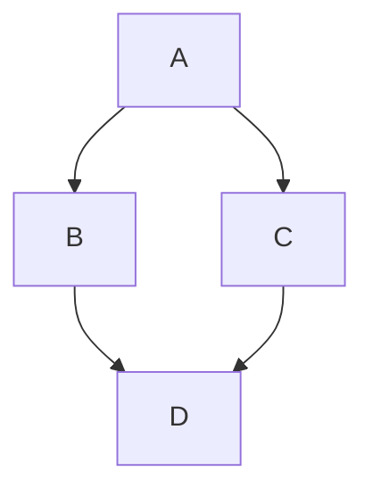
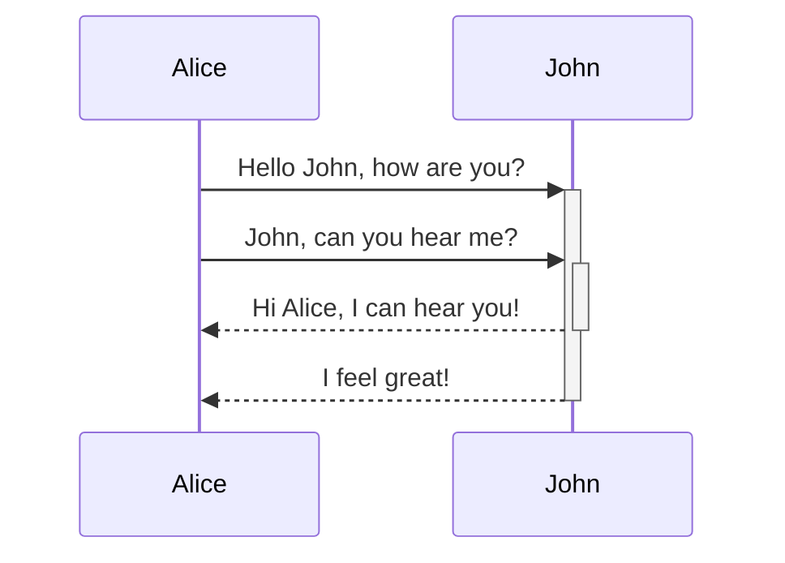

# Using Markdown

ExoDeck uses a powerful Markdown engine to render rich text in Note pages and item descriptions.

## Basic Formatting

You can use standard markdown syntax:

- **Bold text** with `**bold**`
- *Italic text* with `*italic*`
- [Links](https://example.com) with `[Link text](URL)`
- `Inline code` with backticks

## Code Blocks and Syntax Highlighting

ExoDeck supports syntax highlighting for a wide variety of programming languages.

```java
public class HelloWorld {
    public static void main(String[] args) {
        System.out.println("Hello, World!");
    }
}
```

## Mermaid Diagrams

You can embed Mermaid diagrams directly into your notes using the `mermaid` language block.





### Interactive Diagram Controls & Mini-Map

Mermaid diagrams in Note pages automatically feature an interactive viewer with zoom, pan, and a mini-map:

- **Pan**: Click and drag anywhere on the diagram canvas to pan.
- **Zoom**:
  - Hold **`Ctrl`** (or **`Cmd`**) and scroll the mouse wheel over the diagram to zoom in and out centered at your cursor.
  - Use the floating toolbar buttons for **Zoom In** (`+`), **Zoom Out** (`-`), or **Fit to View** (`0`).
  - Pinch-to-zoom is supported on trackpads and touch devices.
- **Mini-Map**:
  - A scaled mini-map appears in the bottom-right corner showing the entire diagram.
  - The highlighted viewport rectangle indicates which portion is currently visible.
  - **Drag** the viewport rectangle on the mini-map to pan around the diagram.
  - **Click** anywhere inside the mini-map to instantly jump and center on that section.
  - Toggle the mini-map on or off anytime using the **Mini-map** button in the toolbar.
- **Fullscreen Mode**:
  - Click the **Fullscreen** button in the toolbar (or press `f` when focused) to view large diagrams across your entire screen.
  - In fullscreen mode, scrolling with the mouse wheel zooms directly without needing `Ctrl`.
  - Press **`Escape`** or click the close button to exit fullscreen mode.
- **Adaptive Sizing & Clean Printing**:
  - Landscape diagrams dynamically size height to utilize 100% of the available content width without artificial height limits or blank side borders.
  - Tall portrait diagrams automatically adapt to a balanced card framing rather than being squashed into an extreme letterbox or stretched vertically.
  - In Print view, all controls, toolbars, and mini-maps are automatically hidden, diagrams align to the left margin without right-edge clipping, and low width/height ratio diagrams have their font capped to heading size.

## Tables

Markdown tables on Note pages support inline editing and **Auto Sum**:

- Hover over a table and click the **Edit Table** button to edit cells directly, press `Tab` in the last cell to add a row, or hover between header columns to insert a column.
- Click the **Auto Sum** (`Σ`) toggle button (to the left of the Edit or Cancel button) to display row sums on the right, column sums at the bottom, and the total sum in the lower-right corner using your browser's current locale.

| Item | Quantity | Unit Value |
| :--- | ---: | ---: |
| Licenses | 10 | 25 |
| Hosting | 2 | 40 |
