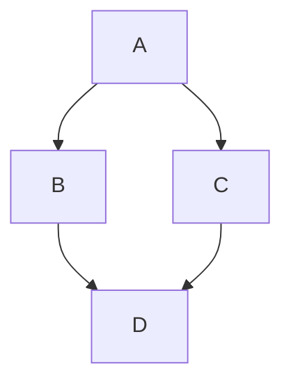
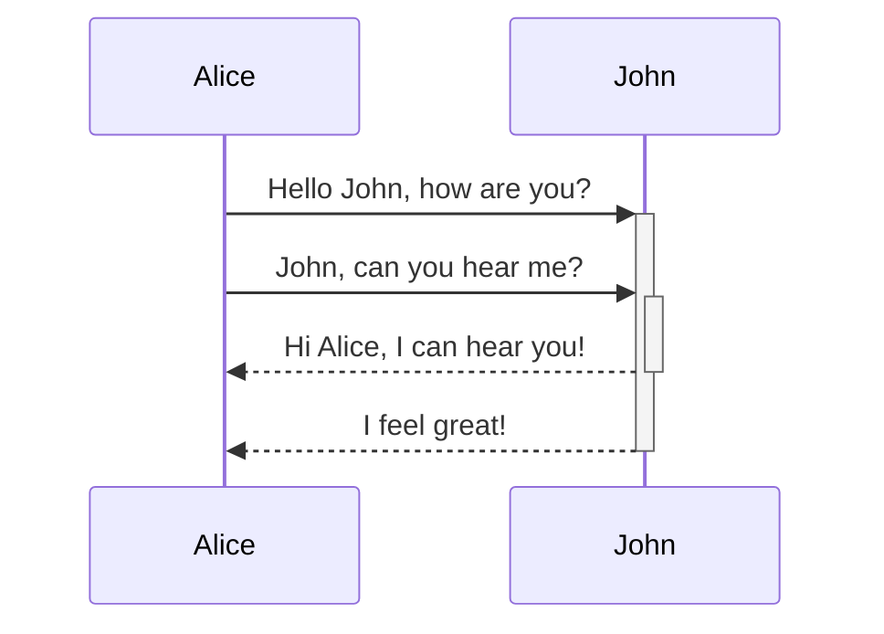

# Using Markdown

ExoDeck uses a powerful Markdown engine to render rich text in Note pages and item descriptions.

## Basic Formatting

You can use standard markdown syntax:

- **Bold text** with `**bold**`
- *Italic text* with `*italic*`
- [Links](https://example.com) with `[Link text](URL)`
- `Inline code` with backticks

## Code Blocks and Syntax Highlighting

ExoDeck supports syntax highlighting for a wide variety of programming languages.

```java
public class HelloWorld {
    public static void main(String[] args) {
        System.out.println("Hello, World!");
    }
}
```

## Mermaid Diagrams

You can embed Mermaid diagrams directly into your notes using the `mermaid` language block.





## Tables

Markdown tables on Note pages support inline editing and **Auto Sum**:

- Hover over a table and click the **Edit Table** button to edit cells directly, press `Tab` in the last cell to add a row, or hover between header columns to insert a column.
- Click the **Auto Sum** (`Σ`) toggle button (to the left of the Edit or Cancel button) to display row sums on the right, column sums at the bottom, and the total sum in the lower-right corner using your browser's current locale.

| Item | Quantity | Unit Value |
| :--- | ---: | ---: |
| Licenses | 10 | 25 |
| Hosting | 2 | 40 |
